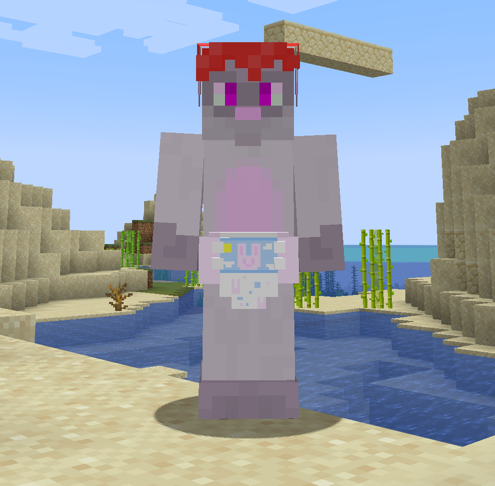
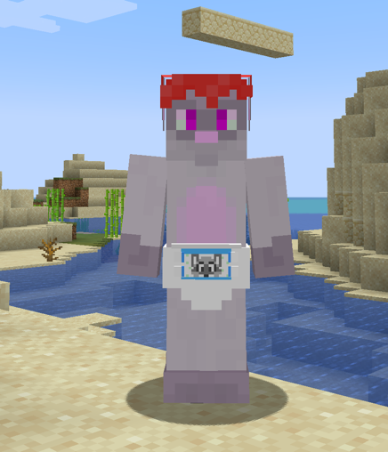
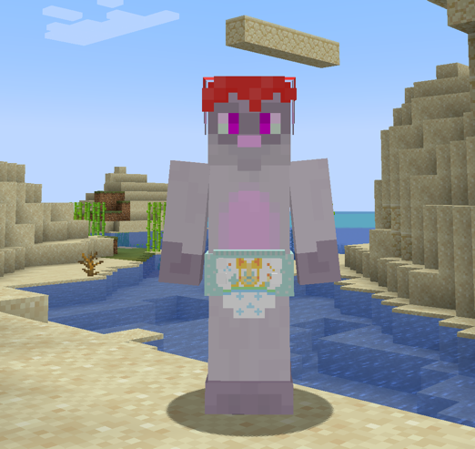
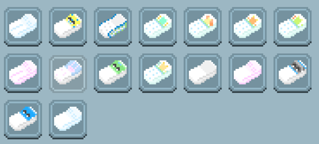

CrinkleMod: A fully-loaded experience.
==========

This is an ABDL mod for Minecraft. It adds diapers, metabolism, and more (soon™)!

## Dependencies
- [Minecraft](https://www.minecraft.net/) (Tested: version 1.20.1)
- [Forge](https://files.minecraftforge.net/net/minecraftforge/forge/) (Tested: version 47.4.28)
- [GeckoLib](https://www.curseforge.com/minecraft/mc-mods/geckolib) (Tested: version 4.8.4)

## Recommended Mods
- JEI (Just Enough Items) for recipes.
- TheOneProbe for information about what you are looking at.

## Installation
1. Download the latest version of the mod from the releases page.
2. Place the downloaded `jar` file into your `mods` folder.
3. Launch Minecraft.
4. Enjoy!

## Tips and Tricks
- The configuration menu is currently available as a button on the pause screen.
- There is a recipe for a Diaper!
- Metabolism is disabled by default. You can enable it in the configuration menu.

## Screenshots

